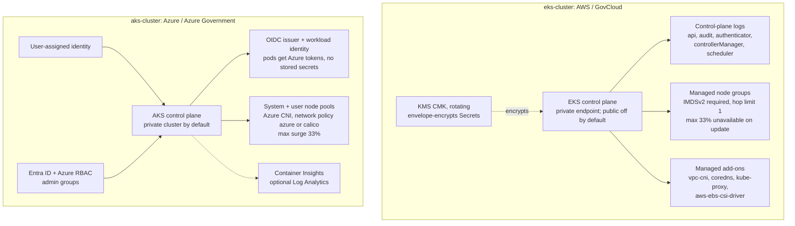

# kubernetes-platform-modules

Opinionated Terraform modules for production-grade Kubernetes clusters on AWS and Azure. Both modules work unchanged in GovCloud / Azure Government environments.

| Module | What it does | Key defaults |
|---|---|---|
| [`eks-cluster`](modules/eks-cluster) | EKS cluster with managed node groups, KMS secrets encryption, and core add-ons | Private API endpoint; IMDSv2 enforced; all control-plane logs on; rotating CMK for secrets |
| [`aks-cluster`](modules/aks-cluster) | AKS cluster with workload identity, Azure RBAC, and network policy | Private cluster; OIDC issuer + workload identity enabled; Azure network policy; user-assigned identity |

## Architecture



## Usage

**EKS**
```hcl
provider "aws" {
  region = "us-gov-west-1"
}

module "eks" {
  source = "git::https://github.com/Krustytoe/kubernetes-platform-modules.git//modules/eks-cluster?ref=v0.1.0"

  name               = "platform-prod"
  kubernetes_version = "1.31"
  subnet_ids         = module.vpc.private_subnet_ids
  tags               = { env = "prod" }
}
```

**AKS**
```hcl
provider "azurerm" {
  features {}
  # For Azure Government: environment = "usgovernment"
}

module "aks" {
  source = "git::https://github.com/Krustytoe/kubernetes-platform-modules.git//modules/aks-cluster?ref=v0.1.0"

  name                = "platform-prod"
  location            = "usgovvirginia"
  resource_group_name = "platform-rg"
  kubernetes_version  = "1.31"
  subnet_id           = module.vnet.subnet_ids["app"]
  tags                = { env = "prod" }
}
```

See [`examples/eks-complete`](examples/eks-complete) and [`examples/aks-complete`](examples/aks-complete) for full working examples.

## Design decisions

- **Private API by default.** EKS keeps the public endpoint off unless you opt in *and* supply `public_access_cidrs`; AKS defaults to a private cluster. Exposure is a deliberate decision, not a default.
- **IMDSv2 with hop limit 1 on every EKS node.** A compromised pod can't reach the node's instance metadata and borrow its IAM credentials, a common container-escape path.
- **Secrets are envelope-encrypted with a customer-managed key.** The module creates a rotating CMK, or you bring your own for centralized key management.
- **Identity over secrets.** AKS enables the OIDC issuer and workload identity so pods authenticate to Azure without mounted credentials; cluster access is governed by Entra ID groups through Azure RBAC.
- **Full control-plane logging on EKS.** `audit` and `authenticator` logs are on by default because they're the first thing an incident responder or assessor asks for.
- **Upgrades trade speed for capacity at 33%.** Node groups roll at most a third of capacity at a time: fast enough for routine patching, conservative enough that a bad image doesn't take the whole pool.
- **Partition-aware.** Managed-policy ARNs are built from `aws_partition`, so the EKS module plans unchanged in `aws` and `aws-us-gov`.

## Requirements

Terraform >= 1.7. EKS: AWS provider >= 5.0. AKS: Azure provider >= 3.100. Run `terraform test` inside any module directory for offline validation — no cloud credentials required.

## Testing

```bash
cd modules/<module>
terraform test
```

All tests use `mock_provider` — no credentials needed.

## License

MIT
